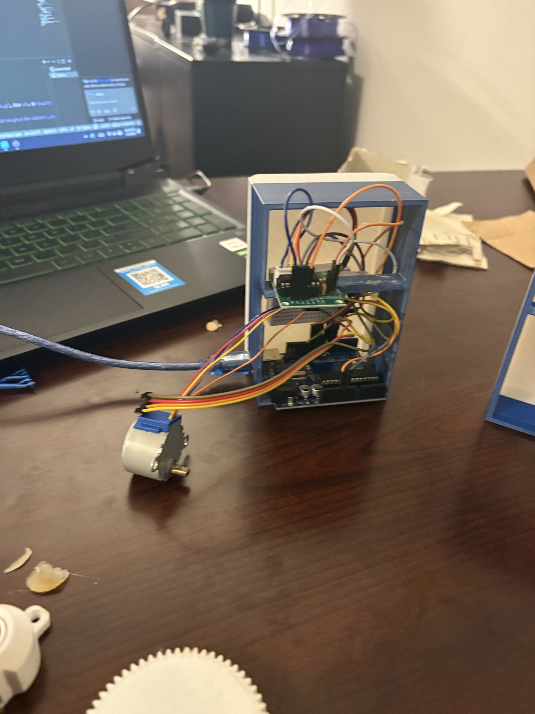
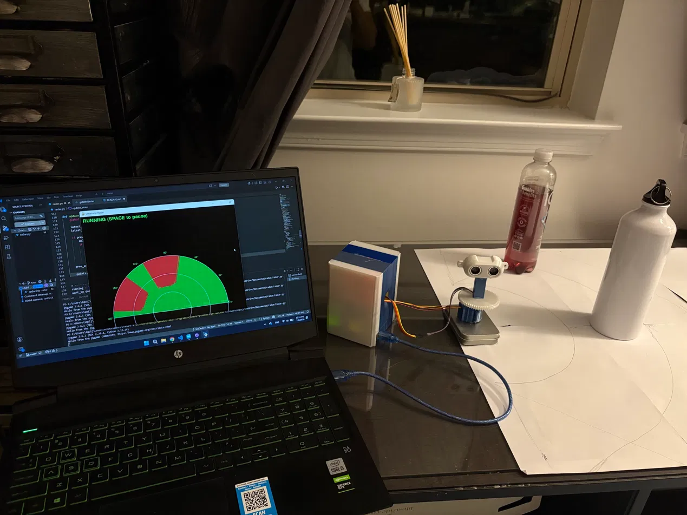

# Ultrasonic Radar

A desk-scale radar built from an Arduino, a 28BYJ-48 stepper motor, and an HC-SR04 ultrasonic sensor. The motor sweeps the sensor back and forth across 180°, the Arduino streams angle/distance readings over serial, and a Python + Pygame script draws it as a sweeping green radar display — full-length rays where it's clear, cut short wherever it detects something.


## Demo

The build, wired up and sitting in its 3D-printed enclosure:



Running on a desk, picking up two "walls" drawn around it on paper:



And here it is actually sweeping:

https://github.com/user-attachments/assets/REPLACE_WITH_YOUR_UPLOADED_VIDEO_ID

> The line above is a placeholder — GitHub doesn't let you embed a video file just by committing it to the repo and linking the path like an image. To get a real embed: open an issue or PR on your repo, drag `images/demo.mp4` straight into the comment box, let it upload, then copy the URL GitHub generates and paste it in place of the line above (delete the placeholder text, keep just the URL on its own line). Once you've done that once, you can delete `images/demo.mp4` from the repo itself if you want — the uploaded copy is hosted independently by GitHub.

## What you'll need

**Hardware**
- Arduino (Uno, Nano, or similar)
- 28BYJ-48 stepper motor + its ULN2003 driver board
- HC-SR04 ultrasonic distance sensor
- A USB cable and a breadboard/jumper wires
- 5V power for the motor (USB is usually fine for just the motor + sensor; if the motor stalls or resets the Arduino, give it its own 5V supply)

**Software**
- [Arduino IDE](https://www.arduino.cc/en/software)
- Python 3.9+
- This repo's two files: `radar.ino` and `radar.py`

## Wiring it up

| Component | Arduino pin |
|---|---|
| ULN2003 IN1 | 8 |
| ULN2003 IN2 | 9 |
| ULN2003 IN3 | 10 |
| ULN2003 IN4 | 11 |
| HC-SR04 TRIG | 6 |
| HC-SR04 ECHO | 7 |
| ULN2003 VCC / HC-SR04 VCC | 5V |
| ULN2003 GND / HC-SR04 GND | GND |

Mount the HC-SR04 on the stepper's output shaft so it physically sweeps with the motor. That's really the whole build.

> A heads-up on the pin order: the `AccelStepper` library wires up its "HALF4WIRE" mode as IN1, IN3, IN2, IN4 — note the middle two are swapped from how you'd naturally wire it. The pin numbers in the table above already account for this. If you wire it differently and the motor jitters in place instead of turning, swap pins 9 and 10 in the code.

## Setting up the Arduino side

1. Open the Arduino IDE.
2. Install the **AccelStepper** library: `Sketch → Include Library → Manage Libraries`, search "AccelStepper" (by Mike McCauley), install it.
3. Open `radar.ino`.
4. Pick your board and port under `Tools` (if you're not sure which port, unplug the Arduino, check the list, plug it back in, see what appears).
5. Hit upload.

Once it's uploaded, the motor won't move yet — it starts paused and waits for a signal from Python (more on that below). That's intentional, not a bug.

## Setting up the Python side

A virtual environment is optional but keeps things tidy:

```bash
python -m venv venv
source venv/bin/activate      # on Windows: venv\Scripts\activate
```

Install the two dependencies:

```bash
pip install pyserial pygame
```

Open `radar.py` and change the serial port on this line to match your setup:

```python
ser = serial.Serial('COM3', 115200, timeout=0)
```

- **Windows**: check Device Manager → Ports (COM & LPT) for something like `COM3`, `COM5`, etc.
- **Mac**: it'll look like `/dev/cu.usbmodem14101` or similar — run `ls /dev/cu.*` in a terminal with the Arduino plugged in to find it.
- **Linux**: usually `/dev/ttyUSB0` or `/dev/ttyACM0` — run `ls /dev/tty*` before and after plugging in to spot it.

## Running it

```bash
python radar.py
```

A black window with a green radar grid should pop up, sitting idle with a "PAUSED — press SPACE to start" message in the corner.

**Press SPACE** to start the sweep. The motor will begin moving, readings will start streaming in, and you'll see the radar line sweep across the display with red "detection" marks wherever something's in range.

**Press SPACE again** to pause mid-sweep — the motor holds wherever it is. Press it once more to resume.

**Close the window** normally (the X button, or Ctrl+C in the terminal) to quit — it'll wait for the sweep to reach a safe position before actually shutting the motor down, so it doesn't try to close mid-motion.

## Tuning it to your setup

A few constants you'll probably want to adjust once it's running:

| Where | What | What it does |
|---|---|---|
| `radar.ino` | `MAX_RANGE_CM` | Max detection range. Keep this equal to the same constant in `radar.py` — if they don't match, the radar will draw detections at the wrong distance from center. |
| `radar.ino` | `stepper.setMaxSpeed(600)` | How fast the motor sweeps. Higher = faster but less stable at the direction reversals. |
| `radar.ino` | `SAMPLE_EVERY_N_STEPS` | How often the sensor is read during the sweep. Lower = more detail, but each reading takes a few milliseconds, so too low can slow the sweep down. |
| `radar.py` | `MAX_RANGE_CM` | Must match the Arduino's value (see above). |

## How it actually works, briefly

- The Arduino drives the stepper back and forth across a fixed step range (0 to roughly 2048 steps = 180°), using the `AccelStepper` library so the motor accelerates/decelerates smoothly instead of slamming into a direction change.
- Every few steps, it pings the HC-SR04 and prints a line like `87.3,22` over serial — angle in degrees, distance in cm (or `-1` if nothing was detected in range).
- Python reads those lines, converts the angle to radians, and tracks whether the sweep is currently moving clockwise or counter-clockwise. The moment the direction flips, it clears the accumulated trail of points, so each full pass starts with a clean slate — which is what gives it that classic "radar wipe" look instead of a messy overlay of old and new data.
- Each reading gets drawn as a line from the center: full length if nothing was detected (sensor sees clear out to max range), or cut short right at the detected object.

## Troubleshooting

**Motor doesn't move at all.** Did you press SPACE? It starts paused on purpose. If you did and it's still not moving, double check the wiring against the pin table and that you installed `AccelStepper` (not the built-in `Stepper` library — they're different).

**Motor jitters in place instead of rotating.** Almost always a pin order issue — swap pins 9 and 10 in the `AccelStepper stepper(...)` line.

**Sweep looks like it's going past 180° and not reversing.** Re-flash the sketch — this usually means an old version without the step-limit check is still on the board.

**Python can't open the serial port / "Access is denied" / "could not open port."** Something else has it open — most commonly the Arduino IDE's Serial Monitor. Close that, then rerun the script. Also double check the `COM3` (or `/dev/...`) value actually matches your Arduino.

**Distance readings look noisy or jump to 0 a lot.** The HC-SR04 is sensitive to angle and surface — soft or angled surfaces absorb or deflect the ping. Try pointing it at something flat and hard first to confirm the sensor itself is working, then troubleshoot your actual target surfaces.

**Radar display lags behind the real motor position over time.** This shouldn't happen with the current script (it drains the whole serial buffer every frame instead of falling behind), but if you've modified the serial-read loop, check that you're still consuming everything in `ser.in_waiting` each frame rather than reading just one line.